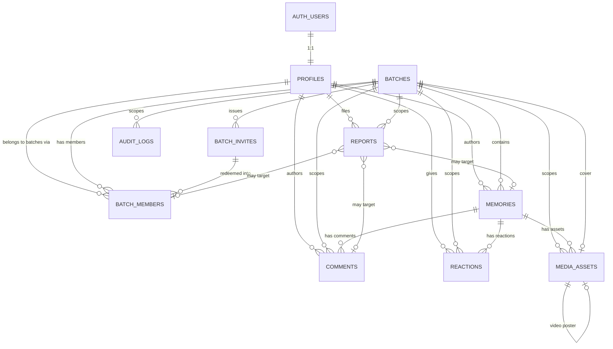
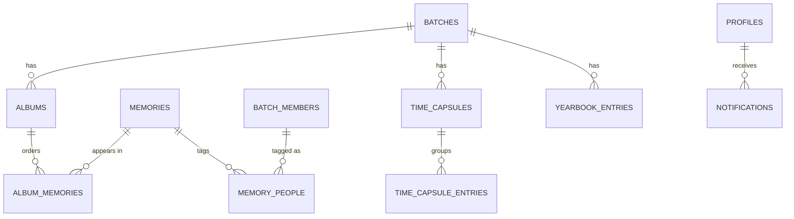

# BatchVault — Database Design

Status: Draft — MVP data model
Sources of truth: `/docs/project-context.md`, `/docs/PRD.md`, `/docs/architecture.md`
Prepared per: `/prompts/04_DATABASE.md`

Target: PostgreSQL (Supabase), single database, RLS on every table.

**Scope of this document.** This is the data model only. No migrations are written, no SQL files are created, and **RLS policy definitions are deliberately absent** — they belong to the security step. What this document does provide is a schema shaped so that those policies are short and hard to get wrong.

**Governing principle** (from the prompt, and from architecture §5): *every private resource must be traceable to the batch it belongs to.* Section 14 explains the mechanism used to guarantee that without letting the denormalization drift.

---

## 1. Entity Overview

### 1.1 MVP tables — planned, to be created during MVP implementation

*(No product table exists yet. These are created by the phase that owns them, per `phases.md`; this document specifies them, it does not mean they have been built.)*

| Table | Purpose | Batch-scoped |
|---|---|---|
| `profiles` | Application-side user record, 1:1 with `auth.users` | No (global) |
| `batches` | The Batch Space: identity, privacy, join policy | Is the scope root |
| `batch_members` | Membership + role + join state, one row per person per batch | Yes |
| `batch_invites` | Shareable invite links/codes (hashed tokens) | Yes |
| `memories` | A dated, captioned entry in the batch archive | Yes |
| `media_assets` | Stored photo/video objects and their metadata | Yes |
| `comments` | Flat comments on a memory | Yes |
| `reactions` | One reaction per member per memory | Yes |
| `reports` | Member-submitted moderation reports | Yes |
| `audit_logs` | Append-only record of privileged actions | Yes (nullable) |

Ten tables. That is the whole MVP.

### 1.2 Post-MVP tables — designed here, **not created**

Designed now because the prompt requires the model and because architecture §16 reserves the module boundaries. **None of these ship in the MVP migration.**

| Table | Purpose | Gated behind |
|---|---|---|
| `albums`, `album_memories` | Curated collections within a batch | PRD §15 |
| `memory_people` | Manual tagging of batch members in a memory | PRD §15 |
| `notifications` | In-app notification records | Architecture §12 |
| `time_capsules`, `time_capsule_entries` | Future-unlock grouping | ADR-11 |
| `yearbook_entries` | Per-member yearbook page | PRD §15 |
| `institutions`, `courses` | Normalized batch identity | §1.3 below |

### 1.3 Entities evaluated and deliberately **not** created

The prompt asked that these be evaluated. Three are rejected outright for MVP, with reasoning:

**`join_requests` → merged into `batch_members`.**
A join request and a membership are the same relationship at different points in its life: *this person, this batch, this state*. Two tables would be the exact failure the prompt warns about — the same relationship expressed twice, in ways that can disagree (a row in both, or a row in neither). A single `batch_members` row with `status ∈ (pending, active, rejected, removed, left)` has one source of truth, one uniqueness constraint (`batch_id, profile_id`), and one place for RLS to look.
*Cost accepted:* a rejected requester who re-requests reuses the same row, so the prior rejection is no longer visible in `batch_members`. That history lives in `audit_logs` (§21), which is where contested decisions belong anyway.

**`institutions` / `courses` → free-text columns on `batches` for MVP.**

| Option | For | Against |
|---|---|---|
| Reference tables now | Clean joins; enables alumni/yearbook rollups later | The MVP has **no batch discovery** (invite-link only, architecture §12), so nothing consumes the normalization. Either the tables are seeded — a data-acquisition project nobody asked for — or users create rows freely, which relocates the duplicate-string problem rather than solving it, and adds a cross-batch write surface to a privacy-first product |
| Free-text on `batches` | Zero new tables, zero new write surface, sufficient for every MVP screen | "IIT Delhi" vs "I.I.T. Delhi" will diverge |

Decision: **free text now.** The divergence is invisible in MVP because batches are never listed side by side. Migration path when discovery or yearbook rollups arrive: create `institutions`/`courses`, add nullable `institution_id`/`course_id` to `batches`, backfill by matching, keep the text columns as display fallback for unmatched rows. Nothing in the MVP schema blocks this. This is also the schema-side half of PRD unresolved decision #8.

**`memory_tags` (topic/free-text tags) → not modeled at all.**
Tagging *people* and tagging *topics* are different features with different privacy characteristics; the only one the product has ever asked for is people (`memory_people`, post-MVP). Cramming both into one polymorphic table to save a table is how the "duplicate the same relationship in incompatible ways" problem starts. Note that person-tagging is **manual only** — facial recognition is permanently excluded by the PRD, and no schema affordance for it exists here.

---

## 2. Relationship Diagram



Post-MVP overlay (not created):



Read the MVP diagram as a star: **`batches` is the hub**, and every private table carries a direct edge to it (§14).

---

## 3–9. Table Definitions

Requirements 3–9 are covered together because they are properties of the same tables. Where to find each: **(3)** table definitions are the subsections below; **(4)** column names and **(5)** data types are the first two columns of every table; **(6)** primary keys are marked **PK**; **(7)** foreign keys appear in the Constraints column and in the "Composite foreign keys" notes; **(8)** unique constraints and **(9)** check constraints are listed per table, either inline or in a dedicated Constraints table.

Conventions applied throughout (rationale in §10–§13):

- **Primary keys**: `uuid`, `default gen_random_uuid()`, except `audit_logs` (`bigint` identity — append-only, index locality matters, never exposed in a URL).
- **Timestamps**: always `timestamptz`, never `timestamp`. Never a bare `date` except where the value genuinely *is* a calendar day with no instant (`memories.occurred_on`).
- **Strings**: `text` with a `CHECK` on length, never `varchar(n)`. Postgres treats them identically in storage, and a `CHECK` can be altered in both directions where a type length cannot be reduced.
- **Enum vs CHECK**: a Postgres `enum` where the value set is structural and stable (`batch_role`, `membership_status`, `media_status`) — removing an enum value is painful, so this is only for sets that will grow by addition if at all. **CHECK-constrained `text`** where the set is an open product decision (`reactions.kind`, `reports.reason`), because PRD unresolved decisions #3 and #5 mean those sets will churn in both directions.
- **Foreign-key indexing is a stated policy, not a blanket rule.** Postgres does not index FK columns automatically, and an unindexed FK turns every parent delete into a sequential scan — but indexing *every* FK would add write cost for lookups that never happen. The exact policy, and a per-FK audit against it, is in **§10.1**.
- **Column-specific `ON DELETE SET NULL`** (PostgreSQL 15+) is used wherever a *composite* FK must null only its optional reference column. See §10.2 — this is a hard version prerequisite.

### Enum types

Listed in **declaration order**, which for `batch_role` is semantically load-bearing (§15):

```
batch_role        : member | moderator | admin | owner        -- ASCENDING capability
membership_status : pending | active | rejected | removed | left
batch_visibility  : private
join_policy       : invite_only_auto_approve | invite_only_requires_approval
media_kind        : image | video
media_status      : pending | ready | rejected
report_status     : open | actioned | dismissed
report_target_kind: memory | comment | member
audit_action      : (see §21)
audit_target_kind : batch | member | memory | comment | media_asset | invite | report
```

`batch_role` is declared **ascending by capability** (`member` lowest, `owner` highest) because Postgres orders enum values by declaration order, and §15 relies on that ordering for comparisons like `role >= 'moderator'`. Any section of this document that prints the roles highest-first is describing the *hierarchy for readers*, never the declaration.

`batch_visibility` has exactly one value today. That is intentional: ADR-12 requires that a future opt-in showcase be an *explicit publication path*, not a relaxation of an existing flag. Naming the axis now (rather than a `bool is_public`) means the future value is added with `ALTER TYPE ... ADD VALUE`, and no one is tempted to bolt on a second, conflicting public/private mechanism later.

---

### 3.1 `profiles`

Application-side user record. One row per authenticated user.

| Column | Type | Constraints | Notes |
|---|---|---|---|
| `id` | `uuid` | **PK**, FK → `auth.users(id)` ON DELETE CASCADE | Same id as the auth user; no surrogate key |
| `display_name` | `text` | NOT NULL, CHECK length 1–80 | |
| `avatar_path` | `text` | NULL | Object path in the avatars bucket; not a URL (URLs are signed per request, architecture §7) |
| `bio` | `text` | NULL, CHECK length ≤ 500 | |
| `onboarding_completed_at` | `timestamptz` | NULL | Gate for architecture §4 / PRD §9.2; NULL = onboarding incomplete |
| `created_at` | `timestamptz` | NOT NULL DEFAULT `now()` | |
| `updated_at` | `timestamptz` | NOT NULL DEFAULT `now()` | Maintained by the shared trigger (§11) |
| `deleted_at` | `timestamptz` | NULL | Soft delete — see §12 |

**Email is deliberately not stored here.** It lives in `auth.users`, owned by Supabase Auth. Duplicating it would create a second copy of PII to keep in sync, leak into every join, and widen the surface that architecture §14's telemetry rules are trying to keep narrow. Anything needing the email reads it from the auth schema server-side.

**Indexes**: PK only. There is no lookup-by-name in MVP (no user directory — this is not a social network).

---

### 3.2 `batches`

The Batch Space. Root of every privacy scope.

| Column | Type | Constraints | Notes |
|---|---|---|---|
| `id` | `uuid` | **PK** | |
| `name` | `text` | NOT NULL, CHECK length 1–120 | Display name |
| `institution_name` | `text` | NOT NULL, CHECK length 1–200 | Free text — see §1.3 |
| `course_name` | `text` | NULL, CHECK length ≤ 200 | |
| `department_name` | `text` | NULL, CHECK length ≤ 200 | |
| `graduation_year` | `smallint` | NULL, CHECK 1900–2200 | |
| `section` | `text` | NULL, CHECK length ≤ 40 | |
| `description` | `text` | NULL, CHECK length ≤ 2000 | |
| `visibility` | `batch_visibility` | NOT NULL DEFAULT `'private'` | |
| `join_policy` | `join_policy` | NOT NULL DEFAULT `'invite_only_requires_approval'` | PRD unresolved #1/#2 — safe default chosen |
| `cover_media_asset_id` | `uuid` | NULL | Composite FK — see below |
| `created_by` | `uuid` | NULL, FK → `profiles(id)` ON DELETE SET NULL | Immutable historical fact, **not** an authorization input |
| `created_at` | `timestamptz` | NOT NULL DEFAULT `now()` | |
| `updated_at` | `timestamptz` | NOT NULL DEFAULT `now()` | |
| `deleted_at` | `timestamptz` | NULL | Soft delete with grace period (PRD §18) |

**There is no `owner_id` column, and that is a decision, not an omission.** Ownership is a role, and roles live in `batch_members`. A `batches.owner_id` alongside `batch_members.role = 'owner'` would be two authorities on the same question that can silently disagree — the precise anti-pattern the prompt names. Instead, "exactly one owner" is enforced by a partial unique index on `batch_members` (§3.3), and ownership transfer is one transaction updating two rows in that one table.

`created_by` is safe to keep because it never changes and never grants anything. It answers "who started this batch," not "who controls it."

**Composite FK for the cover:**

```
FOREIGN KEY (cover_media_asset_id, id) REFERENCES media_assets(id, batch_id)
    ON DELETE SET NULL (cover_media_asset_id)
```

This makes it structurally impossible to set another batch's photo as this batch's cover. See §14. The circular reference (`batches` → `media_assets` → `batches`) is safe because the column is nullable: a batch is created with no cover, media is uploaded, then the cover is set by `UPDATE`.

**The column list on `SET NULL` is mandatory here, not stylistic.** The referencing columns are `(cover_media_asset_id, id)`, and `id` is the batch's own `NOT NULL` primary key. A bare `ON DELETE SET NULL` would attempt to null *both* columns and fail at runtime the first time a cover asset was deleted. Full rationale and the pre-PG15 fallback are in **§10.2**.

**Indexes**: PK; `(created_by)`; `(cover_media_asset_id) WHERE cover_media_asset_id IS NOT NULL`.

---

### 3.3 `batch_members`

Membership, role, and join state. **The hottest table in the system** — every authorization decision reads it.

| Column | Type | Constraints | Notes |
|---|---|---|---|
| `id` | `uuid` | **PK** | |
| `batch_id` | `uuid` | NOT NULL, FK → `batches(id)` ON DELETE CASCADE | |
| `profile_id` | `uuid` | NOT NULL, FK → `profiles(id)` ON DELETE CASCADE | |
| `role` | `batch_role` | NOT NULL DEFAULT `'member'` | |
| `status` | `membership_status` | NOT NULL DEFAULT `'pending'` | Subsumes join requests (§1.3) |
| `invite_id` | `uuid` | NULL, **composite FK** — see below | Provenance: which link brought them in |
| `invited_by` | `uuid` | NULL, FK → `profiles(id)` ON DELETE SET NULL | |
| `requested_at` | `timestamptz` | NOT NULL DEFAULT `now()` | |
| `decided_at` | `timestamptz` | NULL | Approval / rejection / removal timestamp |
| `decided_by` | `uuid` | NULL, FK → `profiles(id)` ON DELETE SET NULL | |
| `joined_at` | `timestamptz` | NULL | Set when status first becomes `active` |
| `created_at` | `timestamptz` | NOT NULL DEFAULT `now()` | |
| `updated_at` | `timestamptz` | NOT NULL DEFAULT `now()` | |

**Constraints**

| Kind | Definition | Why |
|---|---|---|
| UNIQUE | `(batch_id, profile_id)` | One row per person per batch — the constraint that makes the join-request merge safe |
| UNIQUE | `(id, batch_id)` | Composite-FK target (§14) — column order matches every other parent table, and matches how `reports` references it |
| UNIQUE (partial) | `(batch_id) WHERE role = 'owner' AND status = 'active'` | **At most one active owner per batch** |
| CHECK | `role <> 'owner' OR status = 'active'` | An owner cannot be pending, rejected, removed, or departed |
| CHECK | `status <> 'active' OR joined_at IS NOT NULL` | Active membership has a join date |
| CHECK | `status NOT IN ('rejected','removed') OR decided_at IS NOT NULL` | Negative decisions are always attributable in time |

**Composite FK for invite provenance:**

```
FOREIGN KEY (invite_id, batch_id) REFERENCES batch_invites(id, batch_id)
    ON DELETE SET NULL (invite_id)
```

A plain `invite_id → batch_invites(id)` reference was wrong: it allowed a membership in batch A to record that it came from an invite issued for batch B. Provenance that can point across a batch boundary is worse than no provenance, because §16 relies on it for the "a link leaked — who came in through it?" query, and that query must not be able to return members of a different batch. The composite form makes the cross-batch case unrepresentable, exactly as with every other child table (§14).

This requires `UNIQUE (id, batch_id)` on `batch_invites` (§3.4).

`invite_id` stays nullable and keeps working: composite FKs default to `MATCH SIMPLE`, so a row with a NULL `invite_id` is exempt from the constraint regardless of `batch_id`. Members who joined without a link — the batch creator, anyone added directly — are unaffected.

The column list on `SET NULL` is again mandatory: `batch_id` is `NOT NULL`, so a bare `ON DELETE SET NULL` would abort the moment anything deleted an invite. In practice invites are now retained for the life of the batch (§3.4), so this is a safety net rather than an expected path — but a latent abort is still a defect. See §10.2.

**A limitation stated plainly:** the partial unique index enforces *at most* one owner. Postgres cannot declaratively enforce *at least* one — that is a cross-row existence assertion. So "a batch always has an owner" is an application invariant, held by making ownership transfer and account deletion guarded transactions (§13, and unresolved question Q3). The schema makes the *bad* state (two owners) impossible and leaves the *degenerate* state (zero owners) detectable by a query.

**Membership rows are never deleted while the batch lives.** Removal sets `status = 'removed'`, which preserves the audit surface, makes re-invitation an explicit state change rather than a silent re-entry, and keeps the unique constraint meaningful. Hard deletion happens only by cascade when the batch itself is reaped (§12).

**Indexes**
- `UNIQUE (batch_id, profile_id)` — the authorization lookup
- `(profile_id, status)` — "which batches am I in"
- `(batch_id, status)` — member list and pending-approval queue
- `(invite_id) WHERE invite_id IS NOT NULL` — invite provenance, and the referential action when an invite is reaped
- `(invited_by) WHERE invited_by IS NOT NULL`, `(decided_by) WHERE decided_by IS NOT NULL` — sparse attribution FKs, per the §10.1 policy

---

### 3.4 `batch_invites`

Shareable invite links/codes (ADR-08b). No email delivery is implied by this table — the inviter shares the link themselves.

| Column | Type | Constraints | Notes |
|---|---|---|---|
| `id` | `uuid` | **PK** | |
| `batch_id` | `uuid` | NOT NULL, FK → `batches(id)` ON DELETE CASCADE | |
| `token_hash` | `text` | NOT NULL, **UNIQUE** | SHA-256 of the token. **The raw token is never stored** |
| `max_uses` | `integer` | NULL, CHECK > 0 | NULL = unlimited |
| `use_count` | `integer` | NOT NULL DEFAULT 0, CHECK ≥ 0 | |
| `expires_at` | `timestamptz` | NULL | NULL = no expiry |
| `revoked_at` | `timestamptz` | NULL | |
| `revoked_by` | `uuid` | NULL, FK → `profiles(id)` ON DELETE SET NULL | |
| `created_by` | `uuid` | NULL, FK → `profiles(id)` ON DELETE SET NULL | |
| `created_at` | `timestamptz` | NOT NULL DEFAULT `now()` | |
| `updated_at` | `timestamptz` | NOT NULL DEFAULT `now()` | |
| UNIQUE | `(id, batch_id)` | | Composite-FK target for `batch_members.invite_id` (§3.3) |
| CHECK | `max_uses IS NULL OR use_count <= max_uses` | | |

**Storing a hash rather than the token** is the single most important choice in this table. An invite link is a bearer credential; a database dump, a backup, a log line, or an over-broad `SELECT` that exposed raw tokens would hand out live access to private batches. Lookup still works because the hash is deterministic: the server hashes the incoming token and matches on `token_hash`. A salted/slow hash (bcrypt/argon2) is deliberately **not** used — it would make lookup-by-token impossible, and it buys nothing here because the token is already 256 bits of server-generated entropy, so there is no low-entropy secret to protect against offline guessing.

**Validity is computed, never stored as a status column.** An invite is usable when `revoked_at IS NULL AND (expires_at IS NULL OR expires_at > now()) AND (max_uses IS NULL OR use_count < max_uses)`. A stored `status` would be a cached derivation that goes stale the moment a clock passes `expires_at`, and would need a job to stay honest.

**Invite rows are retained for the life of the batch. They are not deleted when they expire.**

An earlier draft had these hard-deleted after expiry, which contradicted §16: `batch_members.invite_id` is the provenance trail that answers *"this link leaked — who came in through it?"*, and deleting the invite row nulls that column via `ON DELETE SET NULL`, destroying the answer at exactly the moment it is needed. A leak is usually discovered long after the link stopped working.

Retention is safe because **the row is not the credential**:

- The raw bearer token was never stored. What remains is `token_hash`, a one-way SHA-256 digest. Holding the digest does not let anyone redeem anything — that would require a preimage.
- **Retaining a row does not retain usability.** Usability is the computed predicate above, nothing else. An expired or revoked invite is dead on arrival at the redeem function no matter how long its row survives, and `expires_at` / `revoked_at` only ever move a link *out* of validity.

So the "retire expired invitations" background step (architecture §13) is a bookkeeping pass, not a delete: it may stamp `revoked_at` on long-expired links to make the dead state explicit rather than merely derived. It never removes the row. Invites leave the database only when the batch itself is reaped and everything cascades (§12).

A consequence worth noting: `ON DELETE SET NULL (invite_id)` on `batch_members` (§3.3) is now a safety net rather than an expected path, since the only thing that deletes an invite is a batch cascade — which removes the memberships too.

**Concurrency**: redemption increments `use_count`, so the redeem function must lock the invite row (`SELECT ... FOR UPDATE`) before checking and incrementing, or two simultaneous redemptions of a single-use link both succeed. This is exactly the kind of multi-row invariant architecture §6 says belongs in a SQL function.

**An invite can only ever produce a plain member.** There is no `role_on_accept` column — it was removed rather than constrained, because a column whose only legal value is `'member'` is not a setting, it is a liability waiting for someone to widen the CHECK.

The reasoning is the nature of the credential. An invite is a **bearer token pasted into a WhatsApp group of 120 classmates** (ADR-08b). Anyone holding it can redeem it, and anyone who redeems it can forward it. If a link could carry `moderator` or `admin`, then a single careless forward — or one screenshot in a group chat — would hand moderation powers to an arbitrary stranger, with no one able to say who authorised it. Privilege must never ride on a shareable artifact.

So: **redemption always writes `role = 'member'`.** Promotion to moderator or admin happens afterwards, through the privileged role-change flow — a deliberate, per-person act by an authorised role, attributable to a named actor and recorded in `audit_logs` (`role_changed`, §21). Ownership moves only via `ownership_transferred`. The invite path and the privilege path are entirely separate, and only the latter leaves a name attached.

Enforcement is honest about its layers, as with the reply-depth cap (§19): the *structural* half is that no column exists for a link to carry a role, so nothing in the schema can express "this link grants admin". The *procedural* half is that the redeem SQL function hard-codes `'member'` and never reads a role from caller input. A CHECK cannot cover the rest — `CHECK (invite_id IS NULL OR role = 'member')` would freeze anyone who joined by link at member forever, blocking the very promotion flow this design routes privilege through.

**Redemption never grants access directly.** It writes a `batch_members` row whose `status` is `active` or `pending` depending on `batches.join_policy` — the link is a way in the queue, not a way past it (architecture §12).

**Indexes**: `UNIQUE (token_hash)` — the redemption lookup; `UNIQUE (id, batch_id)` — composite-FK target; `(batch_id)`; `(created_by)`; `(revoked_by) WHERE revoked_by IS NOT NULL`.

---

### 3.5 `memories`

A dated, captioned entry in the archive. The central content table.

| Column | Type | Constraints | Notes |
|---|---|---|---|
| `id` | `uuid` | **PK** | |
| `batch_id` | `uuid` | NOT NULL, FK → `batches(id)` ON DELETE CASCADE | |
| `created_by` | `uuid` | NULL, FK → `profiles(id)` ON DELETE SET NULL | NULL renders as "former member" |
| `caption` | `text` | NULL, CHECK length ≤ 2000 | |
| `event_name` | `text` | NULL, CHECK length ≤ 200 | |
| `occurred_on` | `date` | **NOT NULL** | The chronological sort key — see below |
| `created_at` | `timestamptz` | NOT NULL DEFAULT `now()` | Upload time |
| `updated_at` | `timestamptz` | NOT NULL DEFAULT `now()` | |
| `deleted_at` | `timestamptz` | NULL | Soft delete |
| `deleted_by` | `uuid` | NULL, FK → `profiles(id)` ON DELETE SET NULL | |
| UNIQUE | `(id, batch_id)` | | Composite-FK target (§14) |

**`occurred_on date NOT NULL` deserves explanation, because the obvious design does not work.**

The natural instinct is a nullable `event_date` and a gallery ordered by `COALESCE(event_date, created_at::date)`. That cannot be indexed: casting `timestamptz` to `date` is **STABLE, not IMMUTABLE** (the result depends on the session `TimeZone`), and Postgres rejects non-immutable expressions in index definitions. Without an index, the gallery — the product's core surface, on mobile — degrades to a sort over the whole batch on every page load.

So the sort key is a single `NOT NULL` column the application always supplies: the user's event date when given, the upload date when not. One column, one meaning, directly indexable, and keyset pagination over `(occurred_on DESC, id DESC)` works cleanly (architecture §19). It is a `date` and not a `timestamptz` because a memory belongs to a *day* — "our farewell was on 12 April" — and forcing an instant onto it invents a timezone the batch never agreed on, which becomes actively wrong when members read it from three countries a decade later.

*(Whether the UI must distinguish "user stated this date" from "we defaulted it" is unresolved question Q5. Deliberately not solved with a second nullable date column, which would reintroduce the duplicate-representation problem.)*

**Multi-asset memories are supported**: one memory has 1..N `media_assets`, ordered by `media_assets.position`. There is no `primary_media_asset_id` column — position 0 is the primary. A dedicated column would be a second, competing way to express "which image represents this memory," and would need its own same-batch and same-memory checks to stay honest.

**No `comment_count` / `reaction_count` columns.** Counter caches need either triggers (business logic in triggers — explicitly discouraged) or a reconciliation job, and both are real bugs waiting to happen for a benefit nobody has measured yet. Counts come from indexed aggregates. If the gallery is later shown to need them, this is a contained addition; see unresolved question Q6.

**Indexes**
- `(batch_id, occurred_on DESC, id DESC) WHERE deleted_at IS NULL` — **the gallery read path**
- `(batch_id, created_by) WHERE deleted_at IS NULL` — a member's own contributions
- `(deleted_at) WHERE deleted_at IS NOT NULL` — retention reaping (§24)
- `(created_by)` — dense FK on the largest content table; needed so account deletion does not sequentially scan the archive. The partial `(batch_id, created_by)` index above does **not** serve this: `created_by` is not leading, and the partial predicate excludes soft-deleted rows that the referential action must still find (§10.1)
- `(deleted_by) WHERE deleted_by IS NOT NULL` — sparse FK

---

### 3.6 `media_assets`

Stored objects and their metadata. **This table is also the upload ledger** — its `id` is the Storage path key that architecture §8 leaves for the database step to decide.

| Column | Type | Constraints | Notes |
|---|---|---|---|
| `id` | `uuid` | **PK** | **This is the storage path identifier** |
| `batch_id` | `uuid` | NOT NULL, FK → `batches(id)` ON DELETE CASCADE | Known at upload-request time |
| `memory_id` | `uuid` | NULL | NULL until finalize |
| `kind` | `media_kind` | NOT NULL | |
| `status` | `media_status` | NOT NULL DEFAULT `'pending'` | `pending` → `ready` \| `rejected` |
| `storage_bucket` | `text` | NOT NULL | |
| `storage_path` | `text` | NOT NULL, **UNIQUE** | Server-composed `{batch_id}/{id}`; stored explicitly so a future convention change cannot orphan existing objects |
| `position` | `smallint` | NOT NULL DEFAULT 0, CHECK ≥ 0 | Order within the memory; 0 = primary |
| `mime_type` | `text` | **NULL while `pending`**; required once `ready` (CHECK below) | The content type **Storage reports for the stored object**, recorded at finalize |
| `byte_size` | `bigint` | **NULL while `pending`**; required once `ready`, CHECK > 0 | Read from the **actual** stored object at finalize (authoritative) |
| `width` | `integer` | NULL, CHECK > 0 | Images; advisory |
| `height` | `integer` | NULL, CHECK > 0 | Images; advisory |
| `client_reported_duration_seconds` | `integer` | NULL, CHECK > 0 | **Videos; UNVERIFIED** — see below |
| `blur_placeholder` | `text` | NULL | Tiny inline placeholder (architecture §9) |
| `content_hash` | `text` | NULL | Integrity verification for long-horizon preservation (§25) |
| `poster_media_asset_id` | `uuid` | NULL | Video poster frame; composite self-FK below |
| `original_filename` | `text` | NULL, CHECK length ≤ 255 | **Untrusted display metadata only** — never a path component (architecture §7) |
| `created_by` | `uuid` | NULL, FK → `profiles(id)` ON DELETE SET NULL | |
| `created_at` | `timestamptz` | NOT NULL DEFAULT `now()` | Upload-request time — drives the orphan sweep |
| `updated_at` | `timestamptz` | NOT NULL DEFAULT `now()` | |
| `deleted_at` | `timestamptz` | NULL | Soft delete; bytes reaped later (§24) |

**Composite foreign keys**
- `(memory_id, batch_id) REFERENCES memories(id, batch_id) ON DELETE CASCADE` — a media asset cannot belong to a memory in a different batch. Because `memory_id` is nullable and Postgres composite FKs default to `MATCH SIMPLE`, **pending rows with a NULL `memory_id` are exempt**, which is exactly the behaviour the two-phase upload needs.
- The poster self-reference:
  ```
  FOREIGN KEY (poster_media_asset_id, batch_id) REFERENCES media_assets(id, batch_id)
      ON DELETE SET NULL (poster_media_asset_id)
  ```
  A poster frame must live in the same batch as its video. The column list is mandatory — `batch_id` is `NOT NULL`, so a bare `SET NULL` would fail when a poster asset is deleted. See **§10.2**.
- `UNIQUE (id, batch_id)` — composite-FK target.

**Readiness CHECK**

```
CHECK (status <> 'ready' OR (memory_id  IS NOT NULL
                        AND byte_size   IS NOT NULL
                        AND mime_type   IS NOT NULL))
```

A ready asset is always attached, always measured, and always carries a recorded content type.

**What "authoritative" means here — and what it does not.** At finalize the server reads two things back from Storage for the object it issued: the **content type Storage reports for that object**, and its **actual stored size**. Both are server-observed rather than caller-asserted, which is what makes them authoritative *relative to the client's declaration* — a caller cannot claim a small JPEG and store a large MP4.

It is **not** content sniffing. The MVP does not open the file, does not parse container headers, and does not inspect the bytes. A reported content type is metadata about the object, so it constrains what the client could get away with declaring — it does not prove what the file actually contains, and it says nothing about codec, container internals, duration or dimensions. The size figure is the one genuinely byte-derived fact, because it is a property of the stored object itself.

This is the same boundary ADR-08a draws, stated at the column level: **type and size are enforced; intrinsic media properties are not.** The future option is unchanged — if intrinsic properties ever need proving, that requires a trusted media-inspection step (`ffprobe` or equivalent) in a trusted server or background environment, which is real added infrastructure and explicitly not in the MVP.

**Why `mime_type` and `byte_size` are nullable — resolving a contradiction in an earlier draft.**

The row is created at upload-*request* time, before a single byte exists (§8 of the architecture, two-phase upload). At that instant there is nothing authoritative to record: no object, no stored size, no server-observed content type. Declaring `mime_type NOT NULL` while also calling it "verified at finalize" was self-contradictory — the only value available at insert time is the client's *declaration*, and treating that as authoritative is precisely what ADR-08a forbids.

So the lifecycle is explicit in the data:

| Stage | `status` | `mime_type` / `byte_size` |
|---|---|---|
| Upload target issued | `pending` | **NULL** — nothing has been observed yet |
| Finalize succeeds | `ready` | Populated from the stored object; NOT NULL by CHECK |
| Finalize rejects | `rejected` | May stay NULL; the row is transient (see below) |

**The client-declared content type is not persisted.** It is a transient gate at upload-request time — checked against the allowlist to refuse an obviously-wrong upload early and to bound what the signed upload target permits — and then discarded. It is deliberately *not* stored in a second column, because a stored declared value invites exactly the mistake this correction removes: a reader picking whichever of two type columns is non-NULL and believing it. One column, one meaning, authoritative or absent.

**`kind` is provisional until finalize.** It is set from the client's declaration at preallocation (it selects the path and drives the upload UI), then reconciled against the authoritative type. A row-local CHECK keeps the two from disagreeing once the asset is real:

```
CHECK (status <> 'ready' OR (kind = 'image' AND mime_type LIKE 'image/%')
                         OR (kind = 'video' AND mime_type LIKE 'video/%'))
```

A file declared as an image that stores as a video cannot reach `ready`; it is rejected and its bytes are removed.

**Rejected uploads: the bytes must go**

`status = 'rejected'` records a finalize-time policy failure — wrong content type, over the size cap, object missing or mismatched. An earlier draft left the fate of the uploaded object unstated, which would allow **untrusted bytes that failed validation to sit in a private batch's bucket indefinitely**. That is not acceptable: the object was never admitted to the archive, so it must not persist.

The rule, following the same **object-first ordering** as every other deletion path (§24):

1. Finalize validation fails → the row is set to `rejected` inside the transaction, so it can never be left claiming `ready`.
2. The same request then attempts to delete the Storage object immediately.
3. If that succeeds, the row is **hard-deleted**. Nothing lingers.
4. If it fails — network blip, Storage error — the row stays `rejected` and the sweep retries.

**The sweep is idempotent by construction.** Deleting an object that is already gone is a no-op, so a retry is always safe, and a row is only ever removed *after* its object is confirmed absent. The reverse order would drop the row that holds `storage_path` and orphan the bytes permanently, which is the failure §24 exists to prevent.

`rejected` rows are therefore **transient, not archival** — they exist only in the window between a failed finalize and the next sweep. If rejection statistics are ever wanted (a member repeatedly pushing oversized files), the place for them is a counter or an abuse signal, not a growing tail of rows pointing at bytes that were supposed to be deleted.

**Position uniqueness within a memory**

```
CONSTRAINT media_assets_memory_position_key
    UNIQUE (memory_id, position) DEFERRABLE INITIALLY IMMEDIATE
```

Position 0 means "primary" (§3.5), so two assets sharing a position in one memory makes the primary ambiguous. A plain index does not prevent that; this constraint does.

Three details make this the right form:

1. **Pending rows stay valid.** Unique constraints treat NULLs as distinct by default (`NULLS DISTINCT`), so any number of pending rows — all with `memory_id IS NULL` — coexist freely, whatever their `position`. **`NULLS NOT DISTINCT` (PG15+) must not be used here**: it would collapse every pending upload in the system into a single allowed row and break the upload flow outright.
2. **`DEFERRABLE` exists because of reordering.** Postgres checks unique constraints per row as a statement progresses, so even a single `UPDATE` that swaps two assets' positions transiently violates uniqueness and aborts. Deferring the check to commit lets a reorder be expressed naturally. `INITIALLY IMMEDIATE` keeps the default strict, so only the reorder transaction pays for deferral by explicitly issuing `SET CONSTRAINTS ... DEFERRED`.
3. **It is a constraint, not a partial index, and therefore not filtered on `deleted_at`.** Only constraints can be deferrable; partial unique *indexes* cannot. The consequence is that a soft-deleted asset keeps its slot until the retention sweep reaps it (§24). That is acceptable and arguably correct: positions need to be *ordered*, not contiguous, new assets take `max(position) + 1`, and holding the slot means restoring a soft-deleted asset cannot collide with something that took its place.

This constraint also gives the `(memory_id, batch_id)` foreign key its supporting index, with `memory_id` leading (§10.1).

**The `client_reported_duration_seconds` name is load-bearing.** Architecture ADR-08a establishes that duration and codec cannot be proven from object metadata; only type and size are authoritatively enforced. Naming the column for what it actually is prevents a future reader from treating it as verified, and means that if `ffprobe`-class inspection is ever added, it lands in a *new*, clearly-verified column rather than silently changing the meaning of this one.

**Why the media row is preallocated (resolving architecture §8's open choice).** At upload-request time the server inserts a `pending` `media_assets` row and uses its `id` as the path key, rather than preallocating a `memories` id. Three reasons:
1. **The orphan sweep gets a table to scan.** Finding abandoned uploads becomes an indexed query over `pending` rows older than the grace window, instead of listing and diffing a Storage bucket.
2. **No phantom memories.** Preallocating a `memories` id would put a row in the archive — or an id with no row — before any bytes exist.
3. **Finalize becomes naturally idempotent.** A retry finds `memory_id` already set and returns the existing memory instead of creating a second one (architecture §18.8).

**Derivatives (thumbnails) are not modelled yet** — architecture §9 leaves the (a) Storage-transformation vs (b) generated-derivative choice open, and columns for an undecided design would be speculation. Under (a) nothing is needed; under (b), derivatives become `media_assets` rows with a `derived_from_media_asset_id` self-FK following the same composite pattern as `poster_media_asset_id` — **including the column-specific action**:

```
FOREIGN KEY (derived_from_media_asset_id, batch_id) REFERENCES media_assets(id, batch_id)
    ON DELETE CASCADE
```

or, if a derivative should outlive its original, `ON DELETE SET NULL (derived_from_media_asset_id)` — never a bare `SET NULL`, for the same `NOT NULL batch_id` reason as the poster FK (§10.2). Unresolved question Q4.

**Indexes**
- `UNIQUE (storage_path)`
- `UNIQUE (memory_id, position) DEFERRABLE INITIALLY IMMEDIATE` — enforces primary-asset unambiguity *and* serves ordered asset fetch for a memory
- `(batch_id)`
- `(created_at) WHERE status <> 'ready'` — **the orphan-and-rejected sweep** (architecture §13). One predicate covers both unfinalized (`pending`) and failed-validation (`rejected`) rows, since both mean "bytes exist that the archive has not accepted". The sweep applies a grace window to `pending` only — an upload may still be in flight — while `rejected` is purged on the next pass
- `(deleted_at) WHERE deleted_at IS NOT NULL` — byte reaping
- `(created_by)` — dense FK on a large table; see §10.1
- `(poster_media_asset_id) WHERE poster_media_asset_id IS NOT NULL` — sparse FK

---

### 3.7 `comments`

| Column | Type | Constraints | Notes |
|---|---|---|---|
| `id` | `uuid` | **PK** | |
| `batch_id` | `uuid` | NOT NULL, FK → `batches(id)` ON DELETE CASCADE | |
| `memory_id` | `uuid` | NOT NULL | |
| `author_id` | `uuid` | NULL, FK → `profiles(id)` ON DELETE SET NULL | |
| `body` | `text` | NOT NULL, CHECK length 1–2000 | |
| `edited_at` | `timestamptz` | NULL | Distinct from `updated_at`, which also moves on soft delete |
| `created_at` | `timestamptz` | NOT NULL DEFAULT `now()` | |
| `updated_at` | `timestamptz` | NOT NULL DEFAULT `now()` | |
| `deleted_at` | `timestamptz` | NULL | |
| `deleted_by` | `uuid` | NULL, FK → `profiles(id)` ON DELETE SET NULL | Author self-delete or moderator removal |
| Composite FK | `(memory_id, batch_id) REFERENCES memories(id, batch_id) ON DELETE CASCADE` | | |
| UNIQUE | `(id, batch_id)` | | Composite-FK target (reports) |

**Threading decision: flat. No `parent_comment_id` in MVP.**
The PRD asks for "comments on a memory" and nothing more. Threading is not free — it brings recursive reads, ordering-within-thread, depth limits, orphaned-parent handling on moderation delete, and a UI that has to render all of it. Adding an unused nullable column now would be building for a hypothetical.

If one-level replies are ever wanted, the *column* part of the migration is small: add `parent_comment_id uuid NULL` with a composite FK `(parent_comment_id, batch_id) → comments(id, batch_id)`. Enforcing the one-level **depth cap** is the part that needs care, and cannot be done with a `CHECK` — see §19.

**`deleted_by` does not record *why*.** Whether a removal was self-deletion or moderation is recoverable from `audit_logs`, and storing a reason here as well would be the same fact in two places.

**Indexes**
- `(memory_id, created_at) WHERE deleted_at IS NULL` — the comment thread
- `(batch_id)`, `(author_id)`
- `(deleted_by) WHERE deleted_by IS NOT NULL` — sparse FK on a large table (§10.1)

---

### 3.8 `reactions`

| Column | Type | Constraints | Notes |
|---|---|---|---|
| `id` | `uuid` | **PK** | |
| `batch_id` | `uuid` | NOT NULL, FK → `batches(id)` ON DELETE CASCADE | |
| `memory_id` | `uuid` | NOT NULL | |
| `profile_id` | `uuid` | NOT NULL, FK → `profiles(id)` ON DELETE CASCADE | |
| `kind` | `text` | NOT NULL, CHECK against an allowlist | `text`+CHECK, not enum — PRD unresolved #3 |
| `created_at` | `timestamptz` | NOT NULL DEFAULT `now()` | |
| `updated_at` | `timestamptz` | NOT NULL DEFAULT `now()` | Moves when the kind is switched |
| Composite FK | `(memory_id, batch_id) REFERENCES memories(id, batch_id) ON DELETE CASCADE` | | |

**Uniqueness rule: `UNIQUE (memory_id, profile_id)` — one reaction per person per memory.**

| Option | Behaviour | Verdict |
|---|---|---|
| `UNIQUE (memory_id, profile_id)` | Switching reaction is an `UPDATE`; a member's response to a memory is a single fact | **Chosen** |
| `UNIQUE (memory_id, profile_id, kind)` | A member can stack every reaction on one memory | Rejected — that is a social-engagement mechanic, and this product is explicitly not optimizing for engagement (project-context §11) |

The chosen rule also works unchanged if the product settles on a single reaction type (PRD unresolved #3): the `kind` column simply never varies. The looser rule could not be tightened later without destroying data.

**Hard delete, no `deleted_at`.** Un-reacting means the reaction did not happen; there is nothing to preserve, no moderation story, and no dispute to adjudicate. Soft-deleting reactions would bloat the hottest count query and force every uniqueness check to filter on `deleted_at`.

**Reactions on comments are not supported**, and if ever added should be a separate `comment_reactions` table rather than a polymorphic `target_type`/`target_id` pair — a polymorphic target cannot carry a real composite FK, which would break the batch-scope integrity guarantee of §14 for the sake of saving one table.

**Indexes**
- `UNIQUE (memory_id, profile_id)` — enforces the rule and serves "did I react?"
- `(memory_id, kind)` — reaction counts per memory
- `(batch_id)`, `(profile_id)`

---

### 3.9 `reports`

Moderation reports (PRD §17).

| Column | Type | Constraints | Notes |
|---|---|---|---|
| `id` | `uuid` | **PK** | |
| `batch_id` | `uuid` | NOT NULL, FK → `batches(id)` ON DELETE CASCADE | Moderation is batch-internal (PRD §17) |
| `reporter_id` | `uuid` | NULL, FK → `profiles(id)` ON DELETE SET NULL | |
| `target_kind` | `report_target_kind` | **NOT NULL**, immutable | Snapshot — `memory` \| `comment` \| `member` |
| `target_id` | `uuid` | **NOT NULL**, immutable, **no FK** | Snapshot — survives the target's deletion |
| `target_memory_id` | `uuid` | NULL | Live reference; nulled if the memory is reaped |
| `target_comment_id` | `uuid` | NULL | Live reference; nulled if the comment is reaped |
| `target_member_id` | `uuid` | NULL | Live reference → `batch_members`; nulled on account deletion |
| `reason` | `text` | NOT NULL, CHECK against an allowlist | `harassment`, `inappropriate`, `privacy`, `spam`, `other` — churns, so CHECK not enum |
| `details` | `text` | NULL, CHECK length ≤ 2000 | |
| `status` | `report_status` | NOT NULL DEFAULT `'open'` | |
| `resolved_by` | `uuid` | NULL, FK → `profiles(id)` ON DELETE SET NULL | |
| `resolved_at` | `timestamptz` | NULL | |
| `resolution_note` | `text` | NULL, CHECK length ≤ 2000 | |
| `created_at` | `timestamptz` | NOT NULL DEFAULT `now()` | |
| `updated_at` | `timestamptz` | NOT NULL DEFAULT `now()` | |

**Constraints**
- CHECK `num_nonnulls(target_memory_id, target_comment_id, target_member_id) <= 1` — **at most** one live reference (see below: after the target is reaped, all three are NULL)
- CHECK `status = 'open' OR resolved_at IS NOT NULL` — a closed report is always attributable in time
- CHECK the live reference agrees with the snapshot kind:
  ```
  CHECK ((target_memory_id  IS NULL OR target_kind = 'memory')
     AND (target_comment_id IS NULL OR target_kind = 'comment')
     AND (target_member_id  IS NULL OR target_kind = 'member'))
  ```
- CHECK the snapshot id cannot lie while the target still exists:
  ```
  CHECK (target_id = coalesce(target_memory_id, target_comment_id, target_member_id))
  ```
  When every live reference is NULL the expression evaluates to NULL, which a CHECK treats as satisfied — so the constraint binds exactly while there is something to compare against, and releases once the target is gone.
- Composite FKs on the **live** references, all same-batch enforced and all column-specific (§10.2):
  ```
  (target_memory_id,  batch_id) → memories(id, batch_id)       ON DELETE SET NULL (target_memory_id)
  (target_comment_id, batch_id) → comments(id, batch_id)       ON DELETE SET NULL (target_comment_id)
  (target_member_id,  batch_id) → batch_members(id, batch_id)  ON DELETE SET NULL (target_member_id)
  ```

**Why a snapshot *and* a live reference — resolving a deadlock in the earlier design**

The previous version had only the three FK columns, with the default `NO ACTION`. That made reports a **blocker**: an open report would prevent the retention sweep from hard-deleting a reported memory or comment (§24), and — worse — would prevent a `batch_members` row from being deleted when someone deleted their account, since `batch_members.profile_id` cascades from `profiles`. A member could have made themselves undeletable by getting reported.

The instinct to fix it with `ON DELETE SET NULL` alone fails the other requirement: the report would survive, but as a record of a complaint about *nothing*, with no way to tell what had been reported. **A single foreign key cannot both retain an identifier and let the referenced row disappear** — that is what a foreign key is for. Two columns are needed because there are two different jobs.

| | Snapshot (`target_kind`, `target_id`) | Live reference (`target_*_id`) |
|---|---|---|
| Purpose | Historical record of *what was reported* | Join to the target while it exists |
| FK | None, deliberately | Composite, same-batch |
| On target deletion | Unchanged | Set to NULL |
| Mutability | Immutable | Changes only via the referential action |

**What is structurally enforced (by the database)**

- The live reference, whenever non-NULL, points at a row that **exists** and is **in the same batch** — the composite FK, unchanged from before and still the mechanism §14 relies on.
- At most one live reference is set, and it matches `target_kind`.
- While the target exists, `target_id` **must equal** the live reference. The snapshot cannot be forged at creation or drifted afterwards.
- `target_kind` and `target_id` are `NOT NULL`, so a report always names what it was about.
- Immutability of the snapshot is enforced the same way `audit_logs` enforces append-only (§21): **column-level privilege**, `REVOKE UPDATE (target_kind, target_id) ON reports`. No trigger — the grant system already says it.
- Deleting a memory, a comment, or a membership is **never blocked** by a report, and **never deletes** the report.

**What is enforced at report creation (by the SQL function)**

Report creation goes through a validated server write path — a SQL function, per architecture §6 — which is the only thing that inserts here. It:

1. resolves the caller's active membership in the batch (a non-member cannot report into a batch);
2. resolves the target, confirming it exists and is of the declared kind;
3. sets `batch_id` from the *target's* batch, not from caller input;
4. writes the snapshot and the live reference together, so the CHECK above binds them.

Step 3 is the privacy-relevant one: it means a caller cannot file a report that mislabels a private row as belonging to a batch they can see. The composite FK would reject the mismatch anyway — this just fails it earlier and more clearly.

**How the live references behave after deletion**

The referential action nulls only the reference column; `batch_id` is untouched because the `SET NULL` is column-specific (§10.2 — a bare `SET NULL` here would try to null the `NOT NULL` `batch_id` and abort the delete, reintroducing the block this correction removes). The report keeps its batch scope, so it stays inside the same batch-scoped RLS shape as everything else and remains visible to that batch's moderators and to nobody else. What a moderator sees afterwards is an honest record: *"a report of kind X about id Y, whose target has since been removed."*

**Duplicate-open-report prevention, after all this**

Deduplication moves onto the **snapshot**, replacing the three per-column indexes:

```
UNIQUE (reporter_id, target_kind, target_id) WHERE status = 'open'
```

One index instead of three, it covers all three target kinds uniformly — including the member case that was missing — and, critically, it **keeps working after the live reference is nulled**, which the old per-column indexes would not have. A member cannot file a second open report about the same target, whether or not that target still exists. A fresh report is still allowed once an earlier one is resolved, and rows whose `reporter_id` was nulled by account deletion drop out of the constraint, which is correct: there is no longer a reporter to deduplicate.

**Why not a bare `target_type` + `target_id` pair, and why not FKs alone.** A purely polymorphic pair is two columns and gives up referential integrity entirely: nothing would stop a report pointing at a row in another batch, or at a UUID that never existed — unacceptable when §14's whole purpose is making cross-batch references unrepresentable. FKs alone fail the opposite way: they guarantee integrity but make the report a blocker, and once the target is legitimately removed they either prevent that removal or forget what was reported.

The hybrid above takes the guarantee from each. The composite FKs enforce existence and same-batch scope **at the moment the report is created**, which is when it matters; the snapshot carries the identity **after the target is gone**, which is when the FK can no longer help. Neither column pair is redundant, and the `target_id = coalesce(...)` CHECK stops them from ever disagreeing while both are live.

**Reports are never deleted, not even softly.** They are the record of a contested decision. Cascade removal with the batch is the only path out.

Repeat reports about a *person* are exactly what a frustrated member generates, and a queue flooded with duplicates is how a real report gets missed — which is why the member target is covered by the snapshot index above rather than left out as it was previously.

**Self-reporting is allowed by design** — PRD §16 treats a member reporting their own upload as a takedown request. No constraint forbids `reporter_id = ` the target's author.

**Indexes**
- `(batch_id, status, created_at DESC) WHERE status = 'open'` — the moderation queue
- `UNIQUE (reporter_id, target_kind, target_id) WHERE status = 'open'` — duplicate suppression across all three target kinds
- `(target_kind, target_id)` — "every report ever filed about this thing", including after it was removed
- `(target_memory_id) WHERE NOT NULL`, `(target_comment_id) WHERE NOT NULL`, `(target_member_id) WHERE NOT NULL` — sparse live references; required so the `SET NULL` actions do not scan (§10.1 Rule B)
- `(reporter_id)`
- `(resolved_by) WHERE resolved_by IS NOT NULL` — sparse FK (§10.1)

---

### 3.10 `audit_logs`

Append-only record of privileged actions (architecture §14).

| Column | Type | Constraints | Notes |
|---|---|---|---|
| `id` | `bigint` | **PK**, GENERATED ALWAYS AS IDENTITY | Sequential — better index locality than random UUIDs for an append-only, time-ordered table, and never appears in a URL |
| `occurred_at` | `timestamptz` | NOT NULL DEFAULT `now()` | |
| `batch_id` | `uuid` | NULL, FK → `batches(id)` ON DELETE SET NULL | Nullable: some actions are account-level |
| `actor_profile_id` | `uuid` | NULL, FK → `profiles(id)` ON DELETE SET NULL | |
| `actor_role` | `batch_role` | NULL | **Role at the time of the action** — a historical fact, never re-derived |
| `action` | `audit_action` | NOT NULL | |
| `target_kind` | `audit_target_kind` | NULL | |
| `target_id` | `uuid` | NULL | **Deliberately no FK** — see below |
| `detail` | `jsonb` | NULL | The one sanctioned JSON column |

`audit_action` values: `member_approved`, `member_rejected`, `member_removed`, `member_left`, `role_changed`, `ownership_transferred`, `invite_created`, `invite_revoked`, `content_removed`, `content_restored`, `report_resolved`, `batch_settings_changed`, `batch_deleted`, `batch_restored`.

**`target_id` has no foreign key on purpose.** An audit record must outlive its subject — the whole point of logging "content_removed" is that the content is gone. A FK would either block the deletion or null out the very fact being recorded. `target_kind` keeps the reference typed without making it enforced.

**`detail jsonb` is the single place JSON is used in this schema**, and the exemption is narrow and defensible: the payload differs per action (old role → new role, previous settings, removal reason), it is written once and never updated, and it is never joined or filtered on relationally. Every other table uses real columns. This is the exception that proves the "do not use JSON for everything" rule rather than an erosion of it.

**Append-only is enforced by privilege, not by trigger.** No role is granted `UPDATE` or `DELETE` on this table, and `INSERT` belongs to the functions that perform privileged actions. **Admin+ read access is not an ordinary direct-client `SELECT` surface** — `security.md` §5.4 keeps `audit_logs` off the directly-queryable API and exposes it through a narrow authorized access path instead; direct client grants are revoked rather than merely policy-restricted (`security.md` §5.1 ground rule 6). The schema is unchanged by this; only the access shape is narrower than "a normal table read." A trigger that raises on `UPDATE` would be business logic in a trigger and is unnecessary when the grant system already says it.

**Audit rows are written by the application, inside the same transaction as the action they describe** — specifically by the SQL functions that perform those actions (architecture §6). Not by triggers: deciding *what is worth auditing* is a product judgement, and burying it in a trigger hides it from the code review that should be scrutinising it.

**`actor_role` is stored, not derived.** If a moderator is later promoted or removed, the log must still say what they were when they acted.

**After a batch is hard-deleted**, surviving audit rows have `batch_id = NULL` and are therefore outside every batch-scoped RLS policy — reachable only via the service role. That is arguably correct (the batch is gone) but it is a real consequence; see unresolved question Q7.

**Indexes**: `(batch_id, occurred_at DESC)` — the per-batch audit view; `(actor_profile_id, occurred_at DESC)`; `(target_kind, target_id)`.

---

## 10. Important Indexes

Consolidated. These are the ones with a named reason; the full foreign-key indexing audit is in §10.1.

| # | Table | Index | Serves |
|---|---|---|---|
| 1 | `batch_members` | `UNIQUE (batch_id, profile_id)` | **The authorization lookup.** Read by essentially every RLS policy in the system — the single most performance-critical index |
| 2 | `memories` | `(batch_id, occurred_on DESC, id DESC) WHERE deleted_at IS NULL` | **The gallery**, including keyset pagination |
| 3 | `batch_invites` | `UNIQUE (token_hash)` | Invite redemption; also enforces token uniqueness |
| 4 | `media_assets` | `UNIQUE (memory_id, position) DEFERRABLE INITIALLY IMMEDIATE` | Guarantees an unambiguous primary asset per memory; also serves ordered asset fetch (§3.6) |
| 5 | `media_assets` | `UNIQUE (storage_path)` | Prevents two rows claiming one object |
| 6 | `media_assets` | `(created_at) WHERE status <> 'ready'` | Orphaned-and-rejected upload sweep — unadmitted bytes must not persist (§3.6, architecture §13) |
| 7 | `comments` | `(memory_id, created_at) WHERE deleted_at IS NULL` | Comment thread on the memory detail page |
| 8 | `reactions` | `UNIQUE (memory_id, profile_id)` | Enforces the uniqueness rule *and* answers "did I react?" |
| 9 | `reactions` | `(memory_id, kind)` | Reaction counts without a counter column |
| 10 | `batch_members` | `(profile_id, status)` | "My batches" on the home screen |
| 11 | `batch_members` | `UNIQUE (batch_id) WHERE role='owner' AND status='active'` | Enforces at most one owner |
| 12 | `reports` | `(batch_id, status, created_at DESC) WHERE status='open'` | Moderation queue |
| 13 | `reports` | `UNIQUE (reporter_id, target_kind, target_id) WHERE status='open'` | Duplicate-report suppression across all three target kinds, on the immutable snapshot so it keeps working after the target is deleted (§3.9) |
| 14 | `audit_logs` | `(batch_id, occurred_at DESC)` | Per-batch audit view |
| 15 | `memories`, `media_assets`, `comments` | `(deleted_at) WHERE deleted_at IS NOT NULL` | Retention reaping (§24) |

Partial indexes are used heavily and deliberately: almost every read path filters `deleted_at IS NULL`, so excluding soft-deleted rows keeps these indexes small and stops dead content from paying rent on every query.

Each parent table additionally carries a `UNIQUE (id, batch_id)` — redundant on its own, but required as a composite-FK target (§14). One extra index per parent table is the price of declarative batch-scope integrity, and it is worth it.

---

### 10.1 Foreign-key indexing policy

An earlier draft claimed *every* FK column is indexed. That was both untrue of the table definitions and not what the schema should do — indexing a rarely-read attribution column costs write throughput on every insert to buy a lookup nobody performs. Indexes here exist for one of three reasons, and the reason determines the shape:

**Rule A — request-path lookups.** A column read to *serve a request* is indexed with that column leading: resolving membership, listing a gallery, fetching a memory's assets, redeeming an invite. A composite index qualifies only if the column is *leading* and the index is not partial in a way that excludes rows the lookup needs.

Not every Rule A index is on a foreign key, and not every foreign key gets one. `batch_invites.token_hash` is the clearest case: it is the single hottest lookup in the redemption path and carries a `UNIQUE` index for that reason *and* to enforce token uniqueness — but it references nothing and is not a foreign key. It appears in this section because it is a lookup key, not because it is an FK.

**Rule B — supporting an important referential action.** A foreign key with `ON DELETE CASCADE` or `ON DELETE SET NULL` forces Postgres to *find* the referencing rows when the parent goes away. Where that parent deletion is an operation users actually wait on, the referencing column is indexed so the action does not scan.

The parent is not always `profiles`. Two distinct cases qualify:

- **Account deletion**, which nulls authorship across the archive (§12). *Dense* columns — nearly always populated — get a plain index: `memories.created_by`, `media_assets.created_by`, `comments.author_id`, `batches.created_by`, `batch_invites.created_by`.
- **Any sparse optional reference cleared by a column-specific `SET NULL`** (§10.2), whoever the parent is. These get a **partial index `WHERE col IS NOT NULL`**, which is far smaller than a full index and just as effective, because the column is NULL for most rows: `memories.deleted_by`, `comments.deleted_by`, `reports.resolved_by`, `reports.target_memory_id`, `reports.target_comment_id`, `reports.target_member_id`, `batch_invites.revoked_by`, `batch_members.invited_by`, `batch_members.decided_by`, `batch_members.invite_id`, `batches.cover_media_asset_id`, `media_assets.poster_media_asset_id`.

Note that several of these parents are not `profiles` at all — a report's live target references a memory, a comment or a membership; the cover and poster references point at `media_assets`; invite provenance points at `batch_invites`. What they share is the shape, not the parent: optional, sparse, and nulled rather than cascaded.

**Rule C — everything else is deliberately unindexed.** Where that leaves a referential action scanning, the scan is *named and accepted* below rather than quietly tolerated. The test is whether anyone is waiting: a rare, bulk, background operation may scan.

**Per-FK audit**

| Table | FK | Action | Serving index | Rule |
|---|---|---|---|---|
| `profiles` | `id → auth.users` | CASCADE | PK | A |
| `batches` | `created_by` | SET NULL | `(created_by)` | B (dense, small table) |
| `batches` | `(cover_media_asset_id, id)` | SET NULL (col) | `(cover_media_asset_id) WHERE NOT NULL` | B (sparse) |
| `batch_members` | `batch_id` | CASCADE | `UNIQUE (batch_id, profile_id)` | A |
| `batch_members` | `profile_id` | CASCADE | `(profile_id, status)` | A |
| `batch_members` | `(invite_id, batch_id)` | SET NULL (col) | `(invite_id) WHERE NOT NULL` | B (sparse) |
| `batch_members` | `invited_by`, `decided_by` | SET NULL | partial `WHERE NOT NULL` | B (sparse) |
| `batch_invites` | `batch_id` | CASCADE | `(batch_id)` | A |
| `batch_invites` | `created_by` | SET NULL | `(created_by)` | B |
| `batch_invites` | `revoked_by` | SET NULL | partial `WHERE NOT NULL` | B (sparse) |
| `memories` | `batch_id` | CASCADE | *(partial only)* | **C — accepted scan** |
| `memories` | `created_by` | SET NULL | `(created_by)` | B (dense) |
| `memories` | `deleted_by` | SET NULL | partial `WHERE NOT NULL` | B (sparse) |
| `media_assets` | `batch_id` | CASCADE | `(batch_id)` | A |
| `media_assets` | `(memory_id, batch_id)` | CASCADE | `UNIQUE (memory_id, position)` | A |
| `media_assets` | `(poster_media_asset_id, batch_id)` | SET NULL (col) | partial `WHERE NOT NULL` | B (sparse) |
| `media_assets` | `created_by` | SET NULL | `(created_by)` | B (dense) |
| `comments` | `batch_id` | CASCADE | `(batch_id)` | A |
| `comments` | `(memory_id, batch_id)` | CASCADE | *(partial only)* | **C — accepted scan** |
| `comments` | `author_id` | SET NULL | `(author_id)` | B (dense) |
| `comments` | `deleted_by` | SET NULL | partial `WHERE NOT NULL` | B (sparse) |
| `reactions` | `batch_id` | CASCADE | `(batch_id)` | A |
| `reactions` | `(memory_id, batch_id)` | CASCADE | `UNIQUE (memory_id, profile_id)` | A |
| `reactions` | `profile_id` | CASCADE | `(profile_id)` | A |
| `reports` | `batch_id` | CASCADE | *(partial only)* | **C — accepted scan** |
| `reports` | `reporter_id` | SET NULL | `(reporter_id)` | B |
| `reports` | `target_*_id` composites (×3) | SET NULL (col) | partial `(target_*_id) WHERE NOT NULL` each | B (sparse) |
| `reports` | `target_kind`, `target_id` | *no FK — snapshot* | `(target_kind, target_id)` | A |
| `reports` | `resolved_by` | SET NULL | partial `WHERE NOT NULL` | B (sparse) |
| `audit_logs` | `batch_id` | SET NULL | `(batch_id, occurred_at DESC)` | A |
| `audit_logs` | `actor_profile_id` | SET NULL | `(actor_profile_id, occurred_at DESC)` | A |

**Accepted sequential scans.** Three cascade paths have only a *partial* index leading with the FK column, so the referential action cannot use it (it must find soft-deleted and non-open rows too):

- `memories.batch_id` and `reports.batch_id` on **batch hard-delete**
- `comments.(memory_id, batch_id)` on **memory hard-delete**

Both parents are hard-deleted only by the retention sweep, long after a grace period — a rare, bulk, background, latency-tolerant operation running in bounded batches (architecture §13). Adding non-partial duplicates of these columns would tax every insert on the three largest tables to speed up an operation measured in "a few times a year, off the request path." The trade is deliberate; if bulk deletion ever becomes routine, adding the plain indexes is a one-line migration.

### 10.2 Column-specific `ON DELETE SET NULL`

Six composite FKs pair an **optional** reference column with the **`NOT NULL`** batch-scoping column:

| Table | Composite FK | Nullable part | `NOT NULL` part |
|---|---|---|---|
| `batches` | `(cover_media_asset_id, id) → media_assets(id, batch_id)` | `cover_media_asset_id` | `id` (the PK) |
| `media_assets` | `(poster_media_asset_id, batch_id) → media_assets(id, batch_id)` | `poster_media_asset_id` | `batch_id` |
| `batch_members` | `(invite_id, batch_id) → batch_invites(id, batch_id)` | `invite_id` | `batch_id` |
| `reports` | `(target_memory_id, batch_id) → memories(id, batch_id)` | `target_memory_id` | `batch_id` |
| `reports` | `(target_comment_id, batch_id) → comments(id, batch_id)` | `target_comment_id` | `batch_id` |
| `reports` | `(target_member_id, batch_id) → batch_members(id, batch_id)` | `target_member_id` | `batch_id` |

The three `reports` entries are load-bearing beyond tidiness: a bare `SET NULL` there would abort on `batch_id`, which would leave the FK effectively blocking, reinstating exactly the deletion deadlock §3.9 sets out to remove.

**A bare `ON DELETE SET NULL` on any of these is a latent runtime failure**, and the earlier draft implied otherwise. A referential action applies to *all* referencing columns, so deleting a cover asset would try to null `batches.id`, and deleting a poster or a reaped invite would try to null `batch_id`. Each violates a `NOT NULL` constraint and aborts the delete. The scoping column is not incidental to these FKs — it is the thing making same-batch integrity structural (§14) — so it must survive.

**The fix is PostgreSQL 15's column-specific form**, which restricts the action to named columns:

```
ON DELETE SET NULL (cover_media_asset_id)
ON DELETE SET NULL (poster_media_asset_id)
ON DELETE SET NULL (invite_id)
```

Only the optional reference is cleared; `batch_id` (or `batches.id`) is untouched. The row then has a NULL in the composite, and under `MATCH SIMPLE` the constraint is simply not enforced for it — the correct outcome: the cover is gone, the batch is intact, the batch scope is unchanged.

**Prerequisite, stated explicitly:** this syntax requires **PostgreSQL 15 or newer**, and the columns named must be nullable. Supabase provisions PG15+, so this is satisfied — but it is a real version floor and belongs in the migration's assumptions, not in a reader's head.

**Fallback if a pre-15 engine were ever targeted** (in preference order):
1. Declare the FK `ON DELETE NO ACTION` and have the SQL function that deletes a media asset clear referencing pointers first, in the same transaction. Consistent with architecture §6, no trigger, and the delete path is already a function.
2. A `BEFORE DELETE` trigger that nulls the pointers — airtight against direct writes, but business logic in a trigger (§11), so it would need to be a deliberate documented exception.
3. Drop the composite form back to a single-column FK — **rejected**, since it abandons the same-batch guarantee that §14 exists to provide.

The same rule applies to any future derivative-media self-FK (§3.6, Q4): a bare `SET NULL` on `(derived_from_media_asset_id, batch_id)` would carry the identical defect.

---

## 11. Created / Updated Timestamps

- Every table has `created_at timestamptz NOT NULL DEFAULT now()`.
- Every mutable table has `updated_at timestamptz NOT NULL DEFAULT now()`.
- `audit_logs` has neither — it has `occurred_at`, and being append-only, an `updated_at` would be a lie.

**`updated_at` is maintained by one shared trigger** (`set_updated_at()`), attached `BEFORE UPDATE` to every mutable table.

This is the **only** trigger in the schema, and it is not an exception to the "no triggers for business logic" rule — it is housekeeping. It makes no decision, reads no other row, and enforces no product rule. The alternative (every writer remembering to set it) fails silently and constantly.

For clarity about what is *not* done with triggers: no counter caches, no cascade emulation, no audit-log writing, no notification fan-out, no membership state transitions, no invite-count enforcement. All of those are business logic and live in SQL functions called explicitly by the application (architecture §6), where they are visible to code review.

---

## 12. Soft-Delete vs Hard-Delete Policy

The product's promise is preservation (project-context §7), so the default leans toward recoverable. But soft-deleting everything is its own bug — every query grows a filter, every uniqueness constraint needs a partial index, and dead rows slow down the live path.

| Table | Policy | Why |
|---|---|---|
| `memories` | **Soft** (`deleted_at`) | Irreplaceable content; accidental deletion must be recoverable; moderation removals may be disputed |
| `media_assets` | **Soft**, bytes reaped later | Row hidden immediately, Storage object deleted after the retention window so a mistake is reversible |
| `comments` | **Soft** | Moderation dispute trail (PRD §17) |
| `batches` | **Soft**, long grace period | The highest-consequence deletion in the product (PRD §18) |
| `profiles` | **Soft** for the graceful path | Attribution survives; see below |
| `batch_members` | **No deletion** — `status = 'removed'` | Removal is a state, not an absence; preserves the audit surface and keeps re-invitation explicit |
| `batch_invites` | **Never deleted** while the batch lives — `revoked_at` | Revocation is a first-class column, and the row is the provenance trail for a leaked link (§3.4). Retention is safe: only a one-way hash is stored, and usability is computed, not implied by existence |
| `reactions` | **Hard** | Un-reacting means it did not happen; nothing to preserve |
| `reports` | **Never deleted** | The record of a contested decision |
| `audit_logs` | **Never deleted** (append-only) | Same |

**Two-stage deletion.** Soft delete hides a row immediately (RLS and queries filter `deleted_at IS NULL`); a scheduled sweep hard-deletes past the retention window (architecture §13). Users get instant feedback, operators get a real undo, and storage does not grow forever.

**Account deletion is where this gets sharp.** `profiles.id` cascades from `auth.users`, so a hard auth deletion removes the profile row. Every authorship column (`memories.created_by`, `comments.author_id`, `media_assets.created_by`, `batches.created_by`) is therefore `ON DELETE SET NULL` rather than `CASCADE`. This is a deliberate, product-driven choice: PRD §16 requires that a departing member's contributions remain part of the batch archive. A cascade would let one person deleting their account silently tear holes in a shared twenty-year record. Content survives; attribution degrades to "former member".

`reactions.profile_id` and `batch_members.profile_id` are the exceptions and do cascade — a reaction and a membership are *about* the person in a way a photograph is not, and leaving anonymous memberships behind would break the ownership constraint and the member list.

The unresolved piece is what happens when the departing account is the batch owner — see Q3.

---

## 13. Ownership Fields

Three distinct notions, kept distinct on purpose:

1. **Batch control** — `batch_members.role = 'owner'` with `status = 'active'`. The single source of truth. Not duplicated onto `batches` (§3.2).
2. **Historical creation** — `batches.created_by`. Immutable, grants nothing, safe to keep because it cannot drift.
3. **Content authorship** — `created_by` / `author_id` / `reporter_id` on content tables. Nullable, `ON DELETE SET NULL`, used for display and attribution, **never for authorization on its own** (a member's right to edit their own memory is still a membership-scoped check).

The product-level statement this encodes: **the batch collectively owns the archive; individuals own their attribution.** That is what makes it a shared time capsule rather than a personal photo dump (project-context §7).

**Ownership transfer** is a single transaction: demote the current owner to `admin`, promote the target member to `owner`, write an `ownership_transferred` audit row. The partial unique index means a buggy implementation that skips the demotion fails loudly on the constraint instead of quietly producing a two-owner batch.

---

## 14. Batch Scoping Rules

This is the core structural decision of the schema, and it directly serves the prompt's principle that every private resource be traceable to its batch.

**Rule 1 — every batch-scoped table carries `batch_id` directly.** Not "reachable via a join through memories". `comments`, `reactions`, `media_assets`, and `reports` all carry `batch_id` even though it is derivable.

The reason is RLS. A policy that must join two or three tables to discover which batch a row belongs to is slower, much harder to read, and far easier to get subtly wrong — and per ADR-03 these policies are the entire privacy guarantee. With a direct column, every policy has the same shape: *does the caller hold an active membership in `this_row.batch_id`?* One predicate, one index (§10 #1), reviewable at a glance. Architecture §5 asks for exactly this via SQL helper functions; this column is what lets those helpers stay one-liners.

**Rule 2 — the denormalization is enforced, never trusted.** A denormalized column that can drift is worse than no column at all, because the policies believe it. So every parent exposes `UNIQUE (id, batch_id)`, and every child references it with a composite foreign key:

```
comments      (memory_id, batch_id)             → memories(id, batch_id)       ON DELETE CASCADE
reactions     (memory_id, batch_id)             → memories(id, batch_id)       ON DELETE CASCADE
media_assets  (memory_id, batch_id)             → memories(id, batch_id)       ON DELETE CASCADE
                                                  -- NULL-exempt while pending
media_assets  (poster_media_asset_id, batch_id) → media_assets(id, batch_id)
                                                  ON DELETE SET NULL (poster_media_asset_id)
batches       (cover_media_asset_id, id)        → media_assets(id, batch_id)
                                                  ON DELETE SET NULL (cover_media_asset_id)
batch_members (invite_id, batch_id)             → batch_invites(id, batch_id)
                                                  ON DELETE SET NULL (invite_id)
reports       (target_*_id, batch_id)           → {memories|comments|batch_members}(id, batch_id)
                                                  ON DELETE SET NULL (target_*_id)
                                                  -- live reference only; the immutable
                                                  -- (target_kind, target_id) snapshot has no FK
```

Note the **column-specific** `SET NULL` on the **six** FKs whose optional reference sits beside a `NOT NULL` scoping column — cover, poster, invite provenance, and the three report targets. A bare `SET NULL` on any of them would try to null the scoping column itself and fail. §10.2 lists all six, including the PostgreSQL 15 prerequisite.

A comment whose `batch_id` disagrees with its memory's `batch_id` is **not a bug to be caught in review — it is unrepresentable.** Postgres rejects the insert. This is what makes Rule 1 safe rather than merely convenient.

**Rule 3 — the batch is the cascade root.** Every batch-scoped table is `ON DELETE CASCADE` from `batches`, so hard-deleting a batch after its grace period removes its entire subtree in one statement, with no orphans and no application-side cleanup script to forget.

**Rule 4 — no cross-batch relationships exist anywhere in the schema.** No table joins two batches. This is checked by inspection: the only tables without a `batch_id` are `profiles` (a global person, deliberately) and `auth.users`. A person can be in many batches; their *data* is never shared between them (PRD §16).

**Rule 5 — global tables stay minimal.** `profiles` holds only what is needed to render a person: name, avatar, bio, onboarding state. No aggregate counts, no cross-batch activity, nothing that could leak the existence of one batch to a member of another.

---

## 15. Membership Role Representation

**A single `role` enum column on `batch_members`, with a strict hierarchy.**

Capability hierarchy, **highest first — this is a reader's summary, not the declaration order**:

```
owner  >  admin  >  moderator  >  member
```

Postgres declaration order, **lowest first — this is the definition, and the ordering the comparisons depend on**:

```
CREATE TYPE batch_role AS ENUM ('member', 'moderator', 'admin', 'owner');
```

Rejected alternatives:

| Option | Why not |
|---|---|
| Boolean flags (`is_admin`, `is_moderator`) | Permits nonsense states (moderator-but-not-member); every check becomes a boolean expression; adding a role means a migration and touching every check |
| A `roles` table + join table (full RBAC) | Real RBAC earns its keep when roles are user-defined. Here there are exactly four, fixed by the PRD. A join table would turn the hottest query in the system into a three-way join to express something an enum says directly |
| Free-text role | No integrity; typos become privilege bugs |

The hierarchy is **totally ordered**, which matters: it means capability checks reduce to a single comparison (`role >= 'moderator'`) rather than set membership, in both SQL helper functions and the `lib/authz` module that mirrors them (architecture §17).

**Declaration order is therefore load-bearing, not cosmetic.** Postgres compares enum values by the order they were declared, so `member, moderator, admin, owner` (ascending capability) is what makes `role >= 'moderator'` mean "moderator or above" with no lookup table and no `CASE` expression. Declaring it the other way round would silently invert every authorization comparison in the system — the checks would still run, still return a boolean, and grant precisely the wrong people access. Any future role must be inserted at the correct rank with `ALTER TYPE ... ADD VALUE ... BEFORE/AFTER`, never appended blindly.

**Role and status are orthogonal columns and must stay that way.** Folding "pending" into the role enum would produce a "pending moderator" question nobody wants to answer, and would break the invariant that role ordering means capability. The `role <> 'owner' OR status = 'active'` check is the one place they legitimately interact.

**Guest / Public Viewer is not a role in this schema.** Per PRD §12 and ADR-12, that identity only exists for explicitly published content and has no membership row by definition — a guest is the *absence* of membership plus a published artifact. Modeling it as a role would put non-members in the members table and quietly weaken every policy that reads it.

---

## 16. Invite Representation

Covered in detail in §3.4. The five properties that matter:

1. **Hashed tokens** — `token_hash` only; the raw bearer token never touches the database.
2. **Computed validity** — no stored `status` column to go stale; validity is `revoked_at IS NULL AND (expires_at IS NULL OR expires_at > now()) AND (max_uses IS NULL OR use_count < max_uses)`.
3. **Multi-use by default with an optional cap** — matches how a link is actually shared (one link into a WhatsApp group of 120 classmates), rather than forcing per-person invites the product does not need.
4. **A link can only ever produce a plain member.** There is no role column on invites at all, so no invite — however it is shared, forwarded or screenshotted — can confer owner, admin or moderator. Privilege comes only from the attributable, audit-logged role-change flow (§3.4).
5. **Redemption yields a membership row, not access** — `status` is `active` or `pending` per `batches.join_policy`. Provenance is retained via `batch_members.(invite_id, batch_id) → batch_invites(id, batch_id)`, so if a link leaks, every account that entered through it is identifiable in one query and can be removed together. The composite form matters here: a single-column `invite_id` would let that leak-response query surface memberships attributed to an invite from another batch (§3.3).

---

## 17. Media Metadata

Covered in §3.6. The design points that carry weight:

- **`media_assets.id` is the Storage path key** — resolving the choice architecture §8 left open, in favour of a preallocated media row over a preallocated memory id (three reasons given in §3.6).
- **Server-observed and caller-asserted metadata are lexically distinguished.** At finalize the server records the content type **Storage reports for the stored object** plus its **actual stored size** — server-observed, not caller-asserted, and therefore **NULL until finalize happens**, since neither exists before the bytes do; a readiness CHECK requires both once `status = 'ready'`. This is metadata about the object, **not content sniffing**: the MVP never opens the file, so it proves nothing about codec or container internals (§3.6). `client_reported_duration_seconds` says in its own name that it is not verified. The client's declared content type is a transient gate at upload-request time and is deliberately never persisted, so no column can be mistaken for an authoritative type it is not. ADR-08a survives contact with the schema instead of quietly eroding.
- **Unadmitted bytes are always removed.** A `rejected` asset's Storage object is deleted by the finalize path, retried idempotently by the sweep, and the row is removed only once the object is confirmed gone — object-first, same as every other deletion path.
- **`storage_path` is stored, not computed.** Deriving it from `{batch_id}/{id}` at read time would mean that the day the convention changes, every existing object becomes unreachable.
- **`original_filename` is display metadata only** — never a path component (architecture §7), and length-capped.
- **`position` orders assets within a memory**; position 0 is primary. No competing "primary asset" column — and a deferrable `UNIQUE (memory_id, position)` constraint makes the primary structurally unambiguous rather than a convention (§3.6).
- **`content_hash`** supports integrity verification over a twenty-year horizon (§25) and would make future deduplication possible; nullable because computing it is opportunistic in MVP.
- **`status`** makes the two-phase upload explicit in data: `pending` rows are the orphan sweep's work queue, `ready` rows are the archive, `rejected` records a finalize-time policy failure without losing the trail.

---

## 18. Reaction Uniqueness Rules

Stated in §3.8; restated here because the prompt calls it out specifically.

**`UNIQUE (memory_id, profile_id)`** — one reaction per member per memory. Switching your reaction updates the row; removing it deletes the row.

- Works unchanged whether the product ships one reaction type or a small fixed set (PRD unresolved #3).
- Cannot be tightened later if the looser `(memory_id, profile_id, kind)` were chosen first, so the restrictive option is the safe default.
- Deliberately not a "like counter" mechanic: a member's response to a memory is one fact, not an accumulating score. Consistent with project-context §11 (not optimizing for engagement).
- `kind` is CHECK-constrained `text` rather than an enum precisely because the value set is an open product question and CHECK constraints can be loosened *and* tightened, while enum values effectively cannot be removed.

---

## 19. Comment Threading Decision

Stated in §3.7. **Flat comments. No `parent_comment_id` in the MVP schema.**

The PRD asks for comments on a memory. Threading brings recursive reads, per-thread ordering, depth caps, orphaned-parent handling when a moderator removes a mid-thread comment, and matching UI — none of it requested, all of it permanent once shipped.

The upgrade path is recorded so it is not redesigned from zero later: a nullable self-referencing `parent_comment_id` with a composite FK on `(parent_comment_id, batch_id) → comments(id, batch_id)`. One level keeps reads non-recursive and is what the interaction actually calls for. Arbitrary-depth trees are rejected for this product outright.

**How the one-level cap would actually be enforced — correcting an earlier claim.**

A `CHECK` constraint **cannot** express "my parent must not itself have a parent." `CHECK` is evaluated against the columns of the row being written and nothing else; reaching into another row makes the expression non-deterministic with respect to that row's later updates, and Postgres does not support it. (Even a `CHECK` wrapping a lookup function would be unsound: Postgres does not re-validate existing rows when the *referenced* row changes, so the invariant would silently rot the first time a parent was re-parented.) There is no purely declarative, row-local way to cap depth. The honest options:

| Option | How | Trade-off |
|---|---|---|
| **Application / SQL-function enforcement** *(preferred)* | The `create_comment` SQL function resolves the parent and rejects a reply-to-a-reply, inside the same transaction | Consistent with architecture §6 — multi-row invariants live in SQL functions. Enforcement is bypassable by anything that writes the table directly, so direct writes must not be granted |
| **Trigger** | `BEFORE INSERT/UPDATE` trigger that reads the parent and raises | Actually airtight against direct writes, but it is business logic in a trigger — currently discouraged (§11). Would need to be a deliberate, documented exception |
| **Different schema** | Replies live in their own table (`comment_replies`) referencing `comments(id, batch_id)` | Depth becomes **structurally** impossible — a reply has nowhere to point but a top-level comment, so no runtime check is needed at all. Costs one table and a `UNION`-shaped read |

If replies are ever built, the third option deserves serious consideration precisely because it needs no enforcement mechanism. What must not happen is shipping a `parent_comment_id` column with a `CHECK` that appears to cap depth and does not.

---

## 20. Notification Representation

**Post-MVP. Not created.** Architecture §12 keeps notifications as a module boundary with no implementation, and the MVP has no in-app notification surface. The model is specified here so that, when it arrives, it does not violate the privacy rules already established.

`notifications` (future):

| Column | Type | Notes |
|---|---|---|
| `id` | `uuid` | PK |
| `recipient_profile_id` | `uuid` | FK → `profiles(id)` ON DELETE CASCADE |
| `batch_id` | `uuid` | NOT NULL, FK → `batches(id)` ON DELETE CASCADE |
| `kind` | `text` | CHECK allowlist — `memory_added`, `comment_added`, `reaction_added`, `join_requested`, `join_approved`, `role_changed` |
| `actor_profile_id` | `uuid` | Who caused it; ON DELETE SET NULL |
| `target_kind`, `target_id` | enum, `uuid` | Reference only |
| `read_at` | `timestamptz` | NULL until read |
| `created_at` | `timestamptz` | |

Binding constraints:

- **References only, never content.** No caption text, no comment body, no display names copied in. Architecture §12 requires that content be resolved at view time behind the normal authorization checks — so a notification generated before someone was removed from a batch cannot leak that batch's content afterwards.
- **`batch_id` is NOT NULL** so notifications sit inside the same batch-scoped RLS shape as everything else, and a recipient removed from a batch stops seeing its notifications by the same rule that stops them seeing its memories.
- **Dedup/collapse** ("3 people reacted") should be a read-time aggregation, not a mutable `count` column — a stored counter is a cache that goes wrong.
- **Fan-out is application-side**, in the SQL function performing the action. Explicitly not a trigger: deciding who gets notified is business logic.
- Index: `(recipient_profile_id, created_at DESC) WHERE read_at IS NULL`.

---

## 21. Audit-Log Strategy

Design in §3.10. The strategy in five points:

1. **Scope: privileged and contested actions only** — the list architecture §14 names (role changes, member removals, moderation removals, ownership transfer) plus invite lifecycle and batch settings/deletion. Not a change-data-capture log of every write. An audit log that records everything gets read by no one.
2. **Written in-transaction by the SQL function performing the action** — never by a trigger, never as a fire-and-forget afterthought. If the action commits, the audit row commits with it; if it rolls back, so does the record.
3. **Append-only by privilege** — no `UPDATE`/`DELETE` grant to any application role, rather than a trigger that raises.
4. **Historical facts are frozen, not re-derived** — `actor_role` stores the role held *at the time*; `target_id` carries no FK so the record survives its subject's deletion.
5. **Readable by batch admins for their own batch** — but through the narrow authorized access path `security.md` §5.4 defines, **not** as an ordinary direct-client table read (§3.10). PRD §17 gives admins a moderation story they must be able to justify; that need is met without opening the table to direct client queries.

`detail jsonb` is the single JSON column in the schema, justified in §3.10: heterogeneous per action, write-once, never queried relationally.

---

## 22. Time-Capsule Locking / Unlock Model

**Post-MVP. Not created.** But the model is fixed now, because ADR-11 constrains it and because getting it wrong would be a privacy failure rather than a feature bug.

**The rule: unlock is a read-time predicate, never a scheduled state change.** A cron job that flips a `locked` flag makes a scheduler a correctness dependency for a privacy guarantee — if it runs early, content leaks; if it fails, the promise breaks silently. A timestamp compared inside an RLS policy cannot run early and cannot fail to run.

**Where the lock lives — the important part.** The natural instinct is to put `unlock_at` on a `time_capsules` table and hide capsule membership. That is wrong: a memory inside a sealed capsule is still a row in `memories`, and it would remain visible through the ordinary gallery path. Two competing visibility mechanisms, one of which loses.

The governing rule, stated once and applied without exception:

> **Every row that stores a sealed payload carries its own read-time unlock predicate.** A lock on a grouping table protects nothing, because the payload is not in the grouping table.

That means **two** locked columns, not one — because a capsule can hold two different kinds of payload:

| Payload | Row that stores it | Where the predicate lives |
|---|---|---|
| An existing memory | `memories` | `memories.locked_until` |
| A standalone message ("a letter to the future") | `time_capsule_entries` | `time_capsule_entries.locked_until` |

An earlier draft put `locked_until` on `memories` only. That left the standalone-message case **completely unprotected**: the message text lives in `time_capsule_entries.message`, so a sealed letter would have been readable by any batch member from the moment it was written, no matter what the capsule said. Correcting it costs one column.

```
time_capsules
  id, batch_id (NOT NULL, cascade), title, description,
  unlock_at timestamptz NOT NULL,
  sealed_at timestamptz NULL,
  created_by, created_at, updated_at
  CHECK (unlock_at > created_at)
  UNIQUE (id, batch_id)

time_capsule_entries
  id, batch_id (NOT NULL), time_capsule_id,
  memory_id     uuid NULL,          -- an existing memory
  message       text NULL,          -- or a letter to the future
  locked_until  timestamptz NULL,   -- read-time predicate for THIS row's payload
  created_by, created_at
  CHECK (num_nonnulls(memory_id, message) = 1)
  composite FKs on (time_capsule_id, batch_id) and (memory_id, batch_id)
  UNIQUE (time_capsule_id, memory_id)
```

Both RLS predicates take the identical shape — `locked_until IS NULL OR locked_until <= now()` — evaluated at read time, per query, by the database. **No cron job unlocks anything.** A scheduler that flips a flag can fire early (content leaks) or fail to fire (the promise breaks silently); a timestamp comparison inside a policy can do neither.

`locked_until` is set on **every** entry row when a capsule is sealed, not only on message-bearing ones. A pointer-only entry carries no payload of its own, but it does reveal *which memory is inside the sealed capsule* — metadata worth withholding until the capsule opens, and uniform treatment removes a per-row case that someone would eventually get wrong.

Sealing is therefore one transaction writing three things: `time_capsules.sealed_at`, `time_capsule_entries.locked_until` for every entry, and `memories.locked_until` for every referenced memory. The capsule row records intent; the payload rows enforce it independently, so neither depends on the other being read correctly.

**Assumption this representation depends on: at most one capsule lock per memory at a time.**

`memories.locked_until` is a **single scalar**, so it can express exactly one lock. That is sufficient only while a given memory participates in at most one sealed capsule. The rule this must never violate:

> **A later capsule must never shorten an earlier privacy lock.** If a memory is already locked until 2035 and is then added to a capsule opening in 2027, blindly writing `locked_until = 2027` would silently unseal content five years early — a privacy failure produced by an ordinary write, with nothing to flag it.

While the one-lock-at-a-time assumption holds, the sealing transaction must therefore refuse to weaken an existing lock: it either rejects adding an already-locked memory to a second capsule, or only ever extends (`locked_until = greatest(existing, new)`, never a bare overwrite). Rejecting is the clearer behaviour, because silently extending would make a capsule's stated unlock date a lie in the other direction.

**If the product ever allows one memory in multiple sealed capsules with different unlock times, this model must be redesigned — not patched.** A single column cannot represent several independent locks, and `greatest()` is not a substitute: it collapses distinct locks into one value, so releasing or cancelling one capsule leaves no way to recover the remaining locks' dates. The shape that works is a separate lock relationship — one row per (memory, capsule) lock — with a visibility rule requiring **every** applicable lock to have expired, evaluated at read time exactly as now.

That larger model is deliberately **not** designed or built here. What is recorded is the constraint the current representation carries, so the assumption is discovered on the whiteboard rather than in a batch's unsealed memories.

Open product question, not a schema question: whether a locked capsule's *existence* is visible (a box you can see but not open — likely the better experience) or entirely hidden. The schema supports both; see Q8.

---

## 23. Yearbook Data Model

**Post-MVP. Not created.** Sketched because the prompt requires it and because it must not duplicate what `batches` and `profiles` already hold.

```
yearbook_entries
  id            uuid PK
  batch_id      uuid NOT NULL  FK → batches(id) ON DELETE CASCADE
  profile_id    uuid NOT NULL
  headline      text NULL      CHECK length ≤ 120     -- "Most likely to..."
  quote         text NULL      CHECK length ≤ 500
  reflection    text NULL      CHECK length ≤ 4000
  portrait_media_asset_id uuid NULL
  favorite_memory_id      uuid NULL
  published_at  timestamptz NULL
  created_at, updated_at, deleted_at

  UNIQUE (batch_id, profile_id)                        -- one page per member per batch
  FK (batch_id, profile_id) → batch_members(batch_id, profile_id)
  composite FKs on (portrait_media_asset_id, batch_id) and (favorite_memory_id, batch_id)
```

Design notes:

- **`FK (batch_id, profile_id) → batch_members(batch_id, profile_id)`** means only an actual member of the batch can have a yearbook page — enforced by the database, not by a check in application code. This reuses the `UNIQUE (batch_id, profile_id)` that already exists for authorization.
- **No `graduation_year` column.** It is already on `batches`, and a batch's yearbook is a batch's yearbook. Copying it here would be the second-source-of-truth mistake.
- **Signatures/notes written *about* a person by classmates** — the emotional core of a physical yearbook — are a *separate* table (`yearbook_notes`: author, subject, body, all batch-scoped), not extra columns here. Self-authored page content and peer-authored notes have different authorship, different moderation exposure, and different edit rights; merging them would produce a table where half the columns are meaningless for half the rows.
- `published_at` allows drafting before the page is visible to the batch.

---

## 24. Data Retention Considerations

Preservation is the product promise (project-context §7, §12), so the default is retain; deletion is the exception and always staged.

| Class | Retention |
|---|---|
| Active memories, media, comments | **Indefinite.** This is the product |
| Soft-deleted content | Hidden immediately; hard-deleted after a retention window; Storage bytes reaped in the same sweep |
| Soft-deleted batch | Long grace period before cascade hard-delete — the highest-consequence deletion in the product (PRD §18) |
| Pending `media_assets` | Swept after a short grace window (hours); the object and its row go together |
| Rejected `media_assets` | **Bytes deleted at the next sweep, no grace window** — they failed validation and were never admitted; the row is removed once the object is confirmed gone (§3.6) |
| Expired / revoked invites | **Retained for the life of the batch.** Not deleted: the row carries the provenance trail (§3.4, §16). Retention is safe because the row holds only a one-way `token_hash`, and usability is the computed validity predicate, not the row's existence |
| Reports, audit logs | Retained for the life of the batch; never independently deleted. Reports no longer block their targets' deletion — the live reference is nulled and the immutable snapshot preserves what was reported (§3.9) |
| Removed memberships | Retained as `status = 'removed'` for the life of the batch |

Implementation notes:

- Every window is enforced by the idempotent, bounded cron sweeps of architecture §13 — never by an ad-hoc script.
- **Row deletion and byte deletion must be ordered**: reap the Storage object first, then the row. The reverse loses the pointer and leaks the object forever. This ordering is a hard requirement on the sweep.
- The exact windows are PRD unresolved decision #5 and #6. The schema is indifferent to the numbers (`deleted_at` plus an interval), so they can be set without a migration.
- **Storage objects are not covered by database backups** (architecture §20); retention policy must be written against both systems or a "restored" memory comes back with no photograph.

---

## 25. Data Export Considerations

Full export tooling is post-MVP (PRD §15), but the schema must not make it infeasible — and preservation-first means designing for the day the archive has to leave.

What the schema does to keep export cheap:

1. **One batch is one connected subtree.** Because `batches` is the cascade root and every private table carries `batch_id` (§14), a full batch export is a set of single-predicate `WHERE batch_id = $1` queries. No graph traversal, no discovering which rows belong to whom.
2. **No proprietary encoding.** Everything is native Postgres types plus original media bytes. No serialized blobs, no application-specific packing, no JSON soup that only this codebase can read. The one `jsonb` column is an audit detail payload, not content.
3. **Media is exportable by construction.** `storage_path` + `original_filename` + `mime_type` + `content_hash` is everything needed to write a real file with a human-meaningful name and then verify it arrived intact.
4. **Attribution survives export** because authorship columns are `SET NULL` rather than `CASCADE` (§12) — an exported archive does not lose its authors when someone deletes their account.
5. **Referential completeness.** Composite FKs guarantee an exported subtree has no dangling references, so a restore or a third-party reader cannot encounter a comment pointing at a memory that was never in the export.

Deliberate exclusions from any export: `batch_invites.token_hash` (a credential), `audit_logs` for a member-facing export (it contains moderation decisions about *other* people), and anything from `auth.users` beyond the exporting user's own identity.

The two open questions are scope and format — per-member vs whole-batch, and JSON+files vs something more archival. Both are product decisions (Q9), and neither is constrained by this schema.

---

## Summary

### Core tables (MVP)

1. **`profiles`** — user record, 1:1 with `auth.users`; no duplicated email
2. **`batches`** — the Batch Space; identity, privacy, join policy; cascade root for everything private
3. **`batch_members`** — membership + role + join state; subsumes join requests; the authorization table
4. **`batch_invites`** — shareable links with hashed tokens and computed validity
5. **`memories`** — dated, captioned archive entries; `occurred_on` is the indexable chronological key
6. **`media_assets`** — objects and metadata; its `id` is the Storage path key and its `pending` rows are the upload ledger
7. **`comments`** — flat comments on a memory
8. **`reactions`** — one per member per memory
9. **`reports`** — moderation reports with real FKs to three possible targets
10. **`audit_logs`** — append-only record of privileged actions

Post-MVP, designed but **not created**: `albums`, `album_memories`, `memory_people`, `notifications`, `time_capsules`, `time_capsule_entries`, `yearbook_entries`, `institutions`, `courses`.

### Most important indexes

1. `batch_members UNIQUE (batch_id, profile_id)` — read by every authorization decision in the system
2. `memories (batch_id, occurred_on DESC, id DESC) WHERE deleted_at IS NULL` — the gallery, with keyset pagination
3. `batch_invites UNIQUE (token_hash)` — invite redemption
4. `reactions UNIQUE (memory_id, profile_id)` — enforces the uniqueness rule and answers "did I react?"
5. `media_assets UNIQUE (memory_id, position) DEFERRABLE INITIALLY IMMEDIATE` — unambiguous primary asset, plus ordered fetch
6. `media_assets (created_at) WHERE status <> 'ready'` — orphaned-and-rejected upload sweep
7. `comments (memory_id, created_at) WHERE deleted_at IS NULL` — the comment thread
8. `batch_members UNIQUE (batch_id) WHERE role='owner' AND status='active'` — at most one owner
9. `batch_members (profile_id, status)` — "my batches"
10. `reports (batch_id, status, created_at DESC) WHERE status='open'` — moderation queue, alongside the single snapshot dedup index `UNIQUE (reporter_id, target_kind, target_id) WHERE status='open'`

### Unresolved schema questions

**Q1 — Default `join_policy`.** Schema defaults to `invite_only_requires_approval` (the safer choice). PRD unresolved #1/#2 must confirm, and decide whether the policy is owner-configurable at all or fixed product-wide.

**Q2 — Reaction `kind` allowlist.** The uniqueness rule is settled; the permitted values are not (PRD unresolved #3). Held as CHECK-constrained `text` so the set can move in both directions.

**Q3 — Owner account deletion.** The schema enforces *at most* one owner but cannot enforce *at least* one. When an owner deletes their account, does the system block deletion until transfer, auto-promote the longest-serving admin, or allow a temporarily ownerless batch that admins can claim? This is the most consequential open item, because it is the one that can leave a batch structurally stuck.

**Q4 — Image derivatives.** Blocked on architecture §9's (a)-vs-(b) choice. Under (b), derivatives become `media_assets` rows with a `derived_from_media_asset_id` self-FK; under (a), no schema change. Not modelled speculatively.

**Q5 — Distinguishing stated vs defaulted `occurred_on`.** Deliberately not solved with a second nullable date column. If the UI must show "date not specified", the cheapest honest fix is a boolean `occurred_on_is_estimated`, not a parallel date.

**Q6 — Counter columns.** No `comment_count` / `reaction_count` in MVP. If the gallery measurably needs them, decide then between a maintained counter (needs a trigger, which the current rules discourage) and a periodically reconciled cache.

**Q7 — Audit rows after batch hard-delete.** `batch_id` becomes NULL, placing the row outside every batch-scoped policy and reachable only by service role. Correct, or should the audit log retain an unenforced batch reference so the trail stays queryable?

**Q8 — Locked time-capsule visibility.** Is a sealed capsule's existence visible to the batch (a box you can see but not open) or entirely hidden? Schema supports both; product must choose before the feature ships.

**Q9 — Export scope and format.** Per-member vs whole-batch, and the archival format. Unconstrained by this schema, but needed before export tooling is built.

**Q10 — UUID generation.** `gen_random_uuid()` (v4) is used throughout. Random v4 keys have poor B-tree insert locality at scale. UUIDv7 would improve it and remains a drop-in change; not worth doing speculatively, worth revisiting if write volume ever justifies it.

---

Prompt 04 complete. This document specifies the data model; it created no migrations, SQL files, or RLS policies, and no product table exists yet. Current project status and next allowed task are tracked in `docs/memory.md`.
